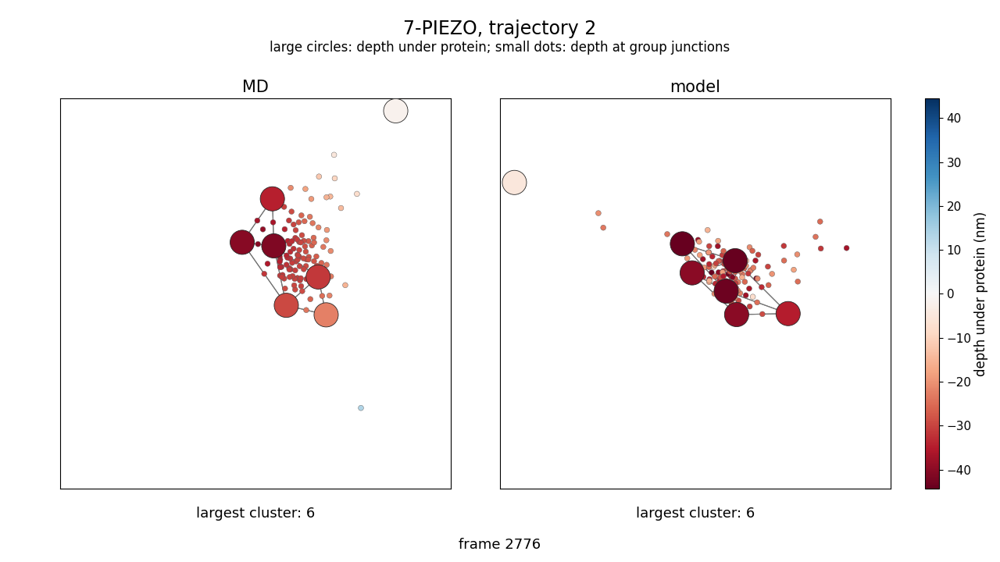
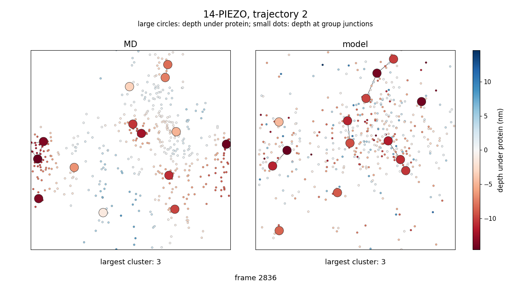

# A hypergraph membrane model for the clustering of PIEZO channels

Jacob Ede Levine\*, Mario Hidalgo-Soria\*, Chen Yun Wen, Sai Chandra Kosaraju, Yun Lyna Luo

\* Equal contribution.

This repository holds the code, the processed molecular dynamics (MD) data, the trained models and the scripts that rebuild the figures and numbers of the paper. The model is a neural stochastic differential equation for the lateral motion of membrane proteins with three additions: a hypergraph membrane module, which generates the membrane depth under each protein and at the junction of every protein group; an excluded-volume module, which scales the part of a proposed step that closes on the nearest neighbor so that proteins stay outside a hard core; and two Kullback-Leibler losses, on log pair distances and on their change over time. Models are trained on the first half in time of each of two coarse-grained MD trajectories of seven PIEZO channels (7-PIEZO) and of fourteen (14-PIEZO), and evaluated on the held-out second halves.

Both MD systems hold copies of a coarse-grained elastic-network model of PIEZO (Wen, Luo and Madsen, Biophysical Reports 5:100238, 2025, [doi:10.1016/j.bpr.2025.100238](https://doi.org/10.1016/j.bpr.2025.100238)), built on the structure of mouse PIEZO2 (Wang et al., Nature 573:225-229, 2019, [doi:10.1038/s41586-019-1505-8](https://doi.org/10.1038/s41586-019-1505-8)) and simulated with LAMMPS (Thompson et al., Computer Physics Communications 271:108171, 2022, [doi:10.1016/j.cpc.2021.108171](https://doi.org/10.1016/j.cpc.2021.108171)).

## Videos

[](videos/7piezo_traj2_centered.mp4)

[](videos/14piezo_traj2_centered.mp4)

Each video shows MD (left) and a rollout of the full model (right) on the held-out second half of trajectory 2, both starting from the same MD frame. The rollouts shown are a best case: the training seed with the lowest held-out clustering score κ on that trajectory, and its rollout with the lowest κ. κ compares the mean and spread of the log pair distances of a rollout with those of MD through a Kullback-Leibler divergence, divided by the same divergence for random placement, so that 0 is a perfect match and 1 is random placement.

Proteins are large circles of diameter equal to the hard core, 21.4 nm, colored by the membrane depth under them. Every hyperedge of the membrane module is a small dot at the junction of its proteins (the periodic mean of their positions), colored by the depth there: 120 hyperedges on 7-PIEZO, one for every group of two or more proteins, and 455 on 14-PIEZO, one for every pair and triple. On the MD side the depths are those of the MD membrane, on the model side those the membrane module generates. Red is below 0 nm and blue above. Gray lines join proteins in contact, within 68.93 nm, and each panel gives the size of its largest contact cluster. The box is periodic and is shifted once, at the start, so that the proteins' center of mass is in the middle. Every fifth frame is shown, at 30 frames per second.

## Contents

| Path | Contents |
|---|---|
| `membrane/`, `nbcore/`, `data/*.py` | the model, its losses and the data loaders |
| `train_brownian_membrane.py` | training |
| `configs/` | the training configurations of the three trained models on each system |
| `data/membrane/half/` | processed MD: protein positions and orientations, and membrane depth under each protein and at each hyperedge junction, for the first and second halves of each trajectory |
| `data/membrane/mesh/` | one frame of the MD membrane height grid, for the overview figure |
| `reproduce/` | rollouts, evaluation, statistics, figures and videos |
| `results/` | the outputs of `reproduce/`: per-run scores, statistics and the numbers of the tables |
| `figures/`, `videos/` | the figures and the two videos |
| `scripts/fetch_assets.py`, `assets_manifest/` | download and check of the release files |
| `tests/` | smoke tests |

## Installation

Python 3.13 and PyTorch 2.10.0 are required; install PyTorch for your CUDA version from pytorch.org, then

```bash
pip install -r requirements.txt
```

The videos also need `ffmpeg` with `libx264`. Rollouts, excluded-volume traces and training need a CUDA GPU; everything else runs on the CPU.

## Release files

The checkpoints and the saved rollouts are files of release `v0.1.0`. With the GitHub CLI logged in, or `GITHUB_TOKEN` set,

```bash
python scripts/fetch_assets.py                    # all of them, 4.4 GB
python scripts/fetch_assets.py --only checkpoints # or heldout, forecast, video
```

downloads them, checks every file against `assets_manifest/` and unpacks them into `assets/`:

| Release file | Contents |
|---|---|
| `checkpoints.tar` | the selected checkpoint of each of the 34 training runs, with its configuration and the per-epoch selection criterion |
| `rollouts_heldout_7piezo.tar`, `rollouts_heldout_14piezo.tar` | 32 rollouts per model, checkpoint and second-half trajectory, as long as the trajectory, from its first frame |
| `rollouts_forecast.tar` | 32 rollouts of 40,000 frames per full-model run and trajectory, every fourth frame kept |
| `video_rollouts.tar` | the two rollouts of the videos with their hyperedge depths |

## Reproducing the paper

From the saved rollouts, on the CPU:

```bash
bash reproduce/run_all.sh
python reproduce/kdyn_split.py && python reproduce/kdyn_where.py   # the change term on 7-PIEZO, Supplementary Section S4
python reproduce/param_count.py                                    # parameter counts
```

`results/RESULTS_half.md` lists the values behind the Results section and Supplementary Tables S3 to S12, per training run and per model, with their tests. `derived_numbers.py` computes the ratios and percentages the text derives from them, and `ablation_overlap_test.py` compares the overlap of the ablation with that of the backbone model.

| Paper | Script | Output |
|---|---|---|
| Figure 1 | `fig_overview.py` | `figures/fig_overview.pdf` |
| Figures 2, 3 and 4, Supplementary Figure S1 | `figures.py` | `figures/fig_squash.pdf`, `fig_clustering.pdf`, `fig_membrane.pdf`, `fig_supp_clustering.pdf`, `results/stats_half.json` |
| Figure 5 | `forecast.py`, `forecast_bump.py` | `figures/fig_forecast.pdf`, `results/forecast_stats_half.json`, `results/bump_half.json` |
| histogram score | `score_histogram.py` | `results/g_half.jsonl` |
| Results, Supplementary Tables S3 to S12 | `results_table.py` | `results/RESULTS_half.md` |
| videos | `roll_hyper_video.py`, `video.py` | `assets/videos/`, `videos/` |

From the checkpoints, on a GPU, `LEVEL=2 bash reproduce/run_all.sh` first draws the held-out rollouts, the forecasts and the excluded-volume traces again (`roll_heldout.py`, `roll_forecast.py`, `trace_squash.py`; `DEVICE` selects the device). The rollouts use seed 3000. Each script skips what it has already written: move `assets/rollouts/heldout/` and `results/rows_half.jsonl`, `assets/rollouts/forecast/`, and `results/traces/` away to draw the held-out rollouts, the forecasts and the traces again.

## Training

```bash
WANDB_MODE=disabled python train_brownian_membrane.py --config-json configs/7piezo/full.json --seed 700
```

trains one run. `configs/<system>/` holds `full.json`, `backbone.json` and `comparison.json`; `default_root_dir` in a configuration sets where its checkpoints go, so give each seed its own. On 7-PIEZO the paper's runs use seeds 700 to 707 for the full model, 700 to 704 for the backbone model and 700 to 705 for the comparison model, and train 40 epochs; on 14-PIEZO every model uses seeds 700 to 704 and trains 20 epochs. The 14-PIEZO runs were trained for 12 epochs and then resumed to 20 with `--resume <run>/last.ckpt`, and runs were resumed after interruptions, so a new run repeats the procedure but not the exact weights. Each run keeps the epoch with the lowest selection criterion, computed on rollouts of the first halves during training and stored per epoch in `fit_objective.jsonl`; `reproduce/select_epochs.py` recomputes the choice into `results/selection_nd.json`, and `reproduce/selection_nd.json` is the paper's. It also lists four unfinished 7-PIEZO runs, seeds 706 and 707 of the comparison model and 708 and 709 of the full model, trained for fewer than 20 epochs; the evaluation skips them and the release omits them.

## Models

| Paper | Run names | Configuration |
|---|---|---|
| full model | `h7_lk_both_sq_s<seed>`, `h14_lk_both_sq_s<seed>` | `full.json` |
| ablation | the full model's checkpoints with the excluded-volume module off at rollout | `full.json` |
| backbone model | `h7_lk_both_s<seed>`, `h14_lk_both_s<seed>` | `backbone.json` |
| comparison model | `h7_base_s<seed>`, `h14_base_s<seed>` | `comparison.json` |

`h7` is 7-PIEZO and `h14` is 14-PIEZO. The backbone model has the losses of the full model and no excluded-volume module, and the comparison model has quantile distance losses in place of the Kullback-Leibler losses.

## Tests

```bash
pytest
```

checks the imports, the configurations and the paths and, when the release files are present, loads a checkpoint and runs one rollout step on the CPU.

## Citation

```bibtex
@unpublished{levine2026hypergraph,
  title  = {A hypergraph membrane model for the clustering of PIEZO channels},
  author = {Levine, Jacob Ede and Hidalgo-Soria, Mario and Wen, Chen Yun and Kosaraju, Sai Chandra and Luo, Yun Lyna},
  note   = {Manuscript},
  year   = {2026}
}
```

## License

MIT, see `LICENSE`.
